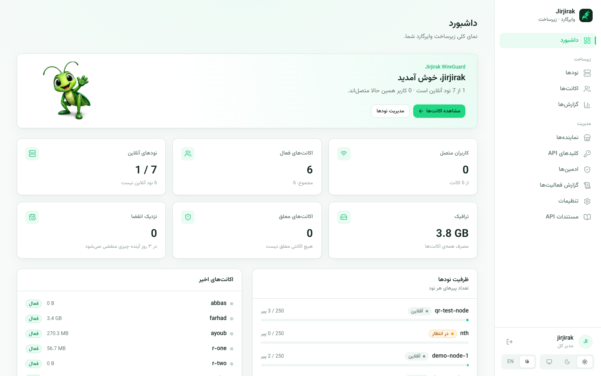
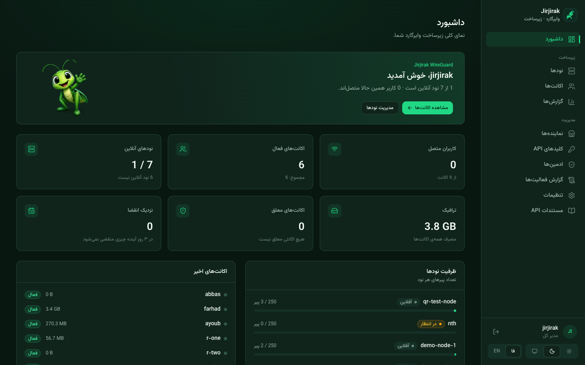
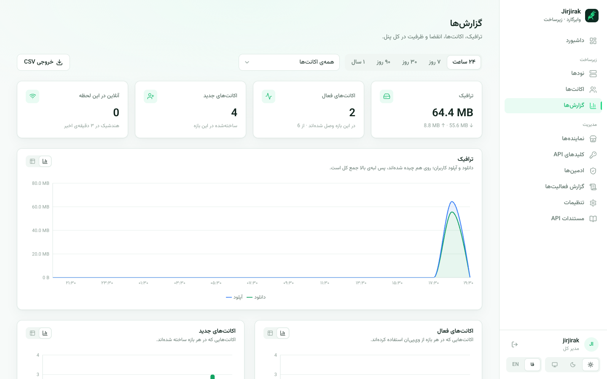
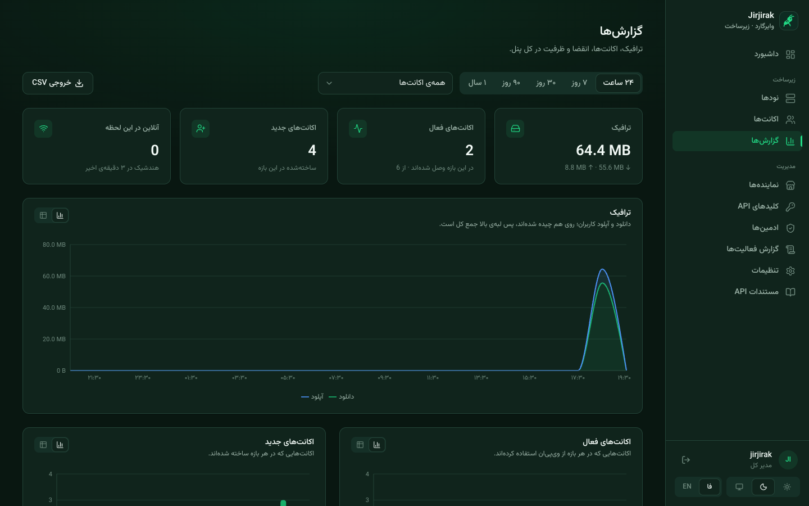
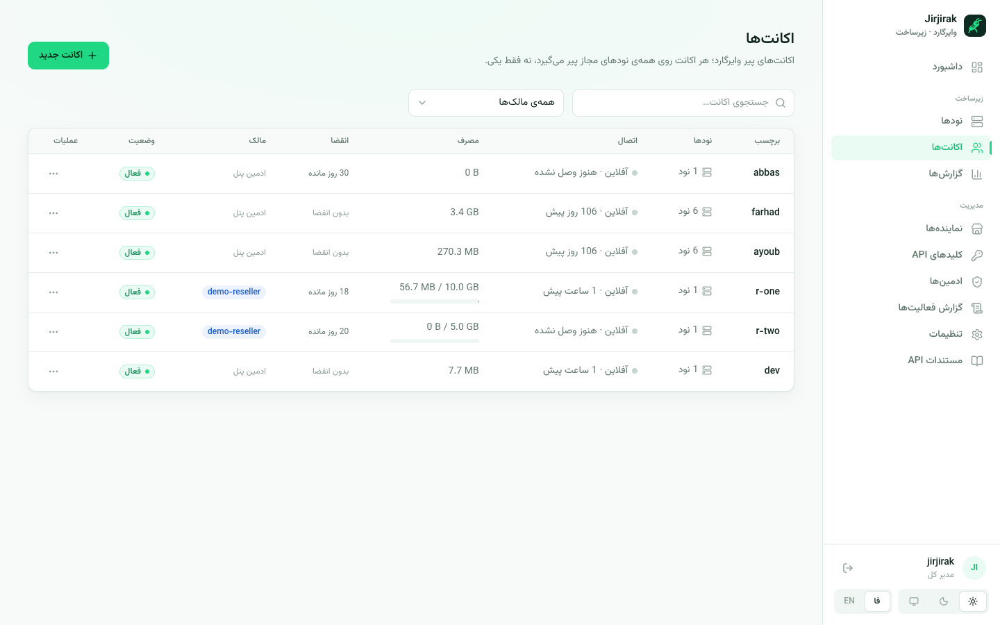
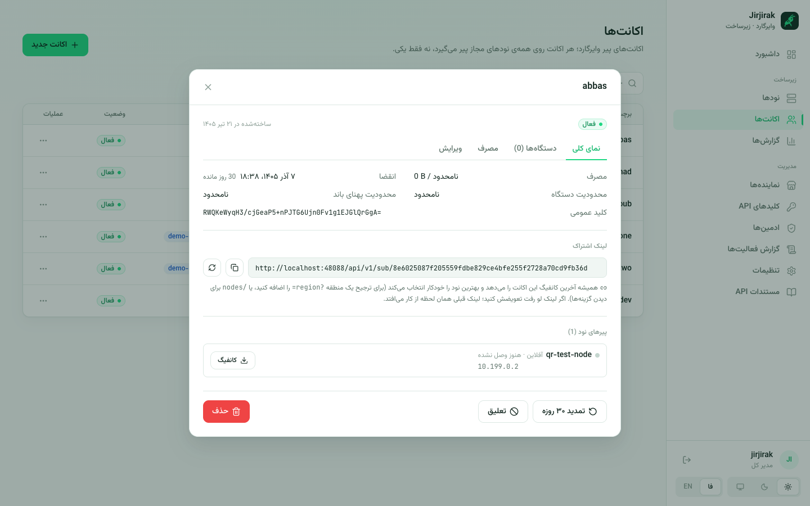
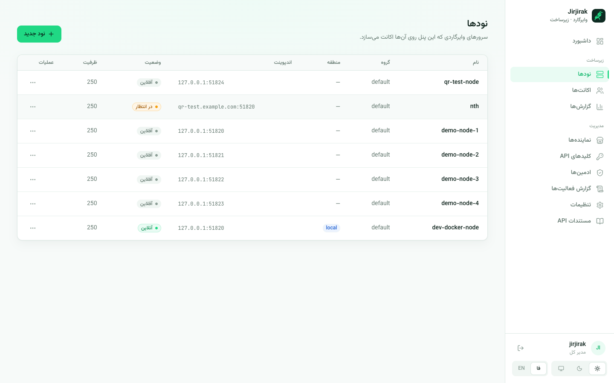
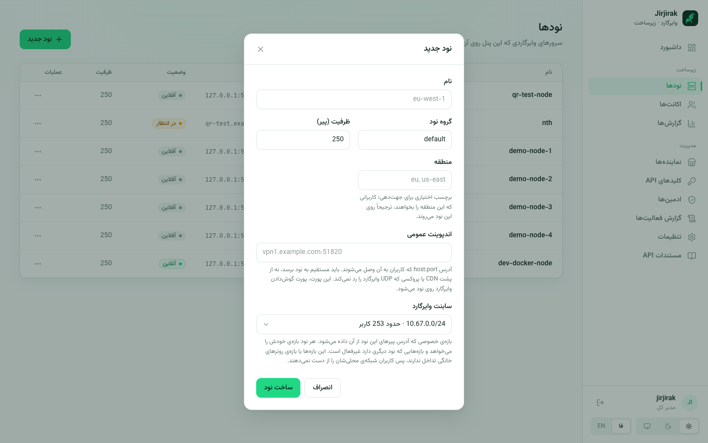
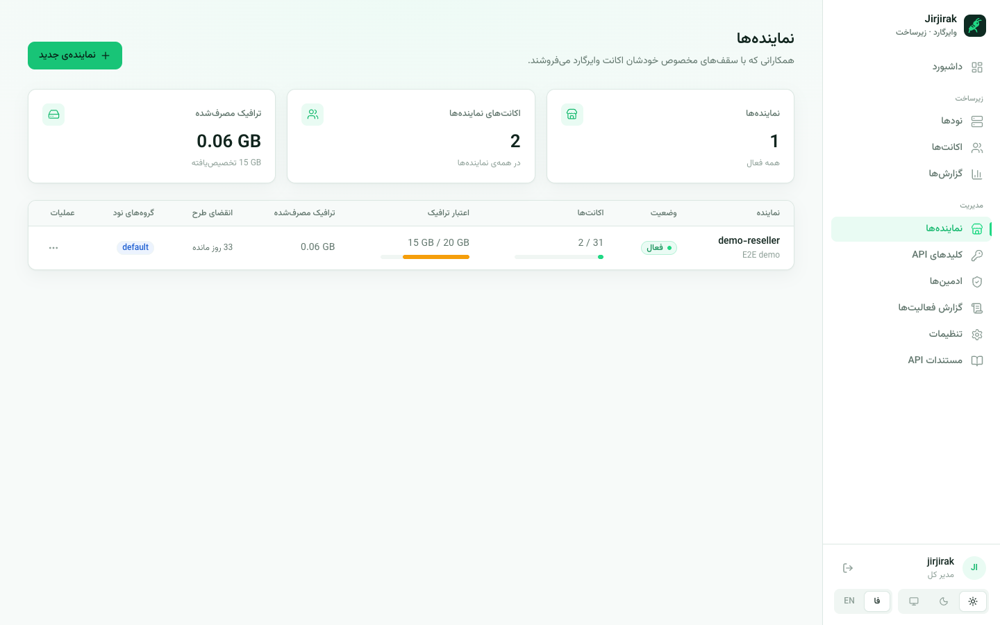
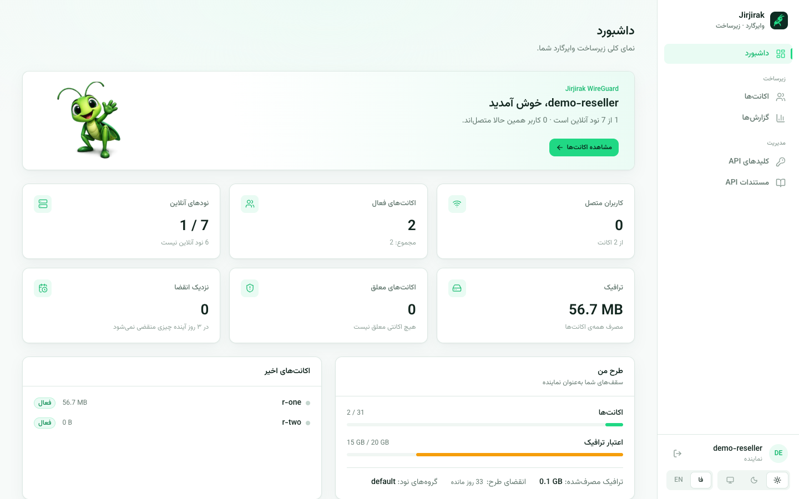

# جیرجیرک وایرگارد (WGPanel)

**فارسی** | [English](README.md)

<p align="center"></p>

جیرجیرک وایرگارد پنلی است برای راه‌اندازی سرویس VPN وایرگارد روی سرورهای خودتان. اکانت‌ها (پیرها) و سرورها (نودها) را مدیریت می‌کند، به نماینده‌ها اجازه می‌دهد با سقف مشخص خودشان اکانت بفروشند، و مصرف، اتصال و سلامت نودها را در یک داشبورد نشان می‌دهد. کل پنل به **فارسی (راست‌به‌چپ)** و انگلیسی در دسترس است، با تم روشن و تیره.

- **چندنودی از اول.** هر اکانت یک بار ساخته می‌شود و روی همه‌ی سرورهای گروهش کار می‌کند، نه فقط روی یک نود.
- **اتصال بی‌دردسر.** هر نود روی گیت‌وی وایرگارد، DNS مخصوص خودش را دارد و ایجنت موقع شروع، شبکه و DNS نود را چک می‌کند. کاربر به محض وصل شدن اینترنت دارد، حتی روی شبکه‌هایی که DNSهای عمومی را می‌بندند.
- **مانیتورینگ زنده.** نمودار ترافیک هر اکانت، تاریخچه‌ی CPU و رم هر نود و وضعیت آنلاین یا آفلاین هر اتصال.
- **گزارش‌ها.** ترافیک، اکانت‌های فعال و جدید، مصرف حجم، انقضاها، پرمصرف‌ترین اکانت‌ها و تفکیک بر اساس نود و نماینده، در بازه‌ی ۲۴ ساعت تا یک سال. هر نمودار نمای جدولی دارد و خروجی CSV هم می‌دهد.
- **نماینده‌ها (ریسلر).** هر نماینده ورود مخصوص خودش و یک طرح دارد: سقف تعداد اکانت، اعتبار ترافیک، گروه نودهای مجاز و تاریخ انقضای طرح. فقط اکانت‌های خودش را می‌بیند و مدیریت می‌کند و برای ربات خودش کلید API می‌سازد.
- **سطح سرویس.** برای هر اکانت می‌شود حجم، تاریخ انقضا، سقف دستگاه و محدودیت پهنای باند گذاشت. اگر کانفیگ بین دستگاه‌های زیادی پخش شود، پنل می‌تواند اکانت را خودکار معلق کند. همه‌ی این‌ها روی تک‌تک نودها اعمال می‌شود.
- **لینک اشتراک.** هر اکانت یک لینک ثابت دارد که همیشه آخرین کانفیگ را از بهترین نود می‌دهد (بر اساس بار، سلامت و منطقه). هر وقت لازم شد لینک را عوض کنید، بدون اینکه کلیدها از نو ساخته شوند.
- **API برای ربات.** با کلیدهای API محدودشده و امضای HMAC، ربات فروش (مثلاً ربات تلگرام) یا ابزار نماینده‌ها اکانت می‌سازد. مستندات API داخل خود پنل هست.
- **دامنه و TLS از داخل پنل.** دامنه‌ی پنل را از تنظیمات عوض کنید؛ Caddy گواهی را خودش می‌گیرد.
- **نقش‌ها و گزارش فعالیت.** مدیر کل، اپراتور، پشتیبانی فقط‌خواندنی و نماینده، به‌همراه سابقه‌ی کارهایی که ادمین‌ها کرده‌اند.

## تصاویر

**داشبورد.** وضعیت کل سرورها در یک نگاه، با تم روشن و تیره:

| روشن | تیره |
| --- | --- |
|  |  |

**گزارش‌ها.** بازه را انتخاب کنید، گزارش را به همه‌ی اکانت‌ها، اکانت‌های ادمین یا یک نماینده محدود کنید و خروجی CSV بگیرید:

| روشن | تیره |
| --- | --- |
|  |  |

**اکانت‌ها.** فهرست اکانت‌ها مصرف در برابر حجم، انقضا، مالک و وضعیت زنده را نشان می‌دهد. صفحه‌ی جزئیات هر اکانت نمای کلی، دستگاه‌ها، نمودار مصرف و ویرایش مستقیم دارد، به‌همراه لینک اشتراک و کانفیگ و QR هر نود:

| اکانت‌ها | جزئیات اکانت |
| --- | --- |
|  |  |

**نودها.** همه‌ی سرورهای وایرگارد با وضعیت، اندپوینت و ظرفیت. موقع ساختن نود جدید، سابنت‌هایی که نود دیگری برداشته غیرفعال‌اند:

| نودها | نود جدید |
| --- | --- |
|  |  |

**نماینده‌ها.** ادمین طرح نماینده‌ها را مدیریت می‌کند. نماینده با همین پنل وارد می‌شود و فقط اکانت‌ها، مصرف طرح و گزارش‌های خودش را می‌بیند:

| نماینده‌ها (دید ادمین) | داشبورد نماینده |
| --- | --- |
|  |  |

## پیش‌نیازها

- یک سرور لینوکسی (اوبونتو یا دبیان) با آی‌پی عمومی، برای خود پنل.
- یک دامنه که به آی‌پی همین سرور اشاره کند، اگر HTTPS خودکار می‌خواهید.
- داکر را اگر نصب نباشد، اسکریپت نصب خودش نصب می‌کند.

## نصب پنل

این را روی سروری اجرا کنید که قرار است پنل رویش باشد:

```bash
curl -fsSL https://raw.githubusercontent.com/iamfarhad/WGPanel/main/deploy/install.sh -o install.sh
sudo bash install.sh
```

اسکریپت نصب این‌ها را می‌پرسد:

- **دامنه‌ی پنل:** باید از قبل به آی‌پی همین سرور اشاره کند (برای HTTPS خودکار با Caddy).
- **ایمیل ادمین:** برای اطلاعیه‌های گواهی Let's Encrypt.
- **نام کاربری مدیر کل:** اکانتی که با آن وارد پنل می‌شوید.
- **نود روی همین سرور:** اینکه وایرگارد روی همین سرور هم به‌عنوان اولین نود نصب شود یا نه. پیشنهادمان «بله» است؛ سرورهای بعدی را بعداً اضافه می‌کنید.

بعد از تمام شدن نصب، پنل روی `https://<دامنه‌ی-شما>` بالاست. رمز مدیر کل خودکار ساخته می‌شود و فقط یک بار، آخر نصب، چاپ می‌شود. همان لحظه ذخیره‌اش کنید. بعداً هم با `wgpanel show-bootstrap-admin` می‌توانید دوباره ببینیدش، تا وقتی لاگ کانتینر پاک نشده باشد.

> **پورت ۸۰ دست سرویس دیگری است؟** اگر وب‌سرور دیگری روی همین سرور پورت ۸۰ را گرفته، در فایل `/opt/wgpanel/.env` مقدار `PANEL_HTTP_PORT` را یک پورت آزاد بگذارید و دوباره `docker compose up -d` بزنید. Caddy این بار گواهی را از روش TLS-ALPN روی پورت ۴۴۳ می‌گیرد.

> **می‌خواهید از صفر شروع کنید؟** اجرای دوباره‌ی `install.sh` فایل `.env` و داده‌ها را نگه می‌دارد. برای پاک کردن همه چیز (کانتینرها، والیوم‌های داده، رمزها و نود همین سرور) و نصب تمیز، `sudo bash install.sh --fresh` بزنید. پنل به‌طور پیش‌فرض از پورت‌های بالا و کم‌استفاده استفاده می‌کند (مثلاً پورت ایجنت نودها `48443` است). اگر پورتی از قبل گرفته شده باشد، اسکریپت با پیغام روشن متوقف می‌شود.

## اضافه کردن سرورهای وایرگارد

همه‌ی نودها، حتی خود سرور پنل، یک‌جور اضافه می‌شوند:

1. در پنل به **نودها ← نود جدید** بروید و اسم، ظرفیت و سابنت وایرگارد را وارد کنید.
2. روی **توکن اتصال** بزنید تا یک توکن یک‌بارمصرف ساخته شود.
3. روی سرور جدید این را اجرا کنید:

   ```bash
   curl -fsSL https://raw.githubusercontent.com/iamfarhad/WGPanel/main/deploy/install-node.sh -o install-node.sh
   sudo bash install-node.sh
   ```

4. آدرس پنل و توکن اتصال را وقتی پرسید وارد کنید.

نود چند ثانیه بعد در پنل **آنلاین** می‌شود و همه‌ی اکانت‌های موجود خودکار رویش پیر می‌گیرند؛ لازم نیست چیزی را دستی همگام کنید.

> اگر ایجنت یک نود را دوباره ثبت می‌کنید (سرور از نو ساخته شده یا سخت‌افزار عوض شده)، به‌جای توکن معمولی یک توکن **نامحدود** بسازید (تیک داخل پنجره‌ی توکن اتصال)، تا لازم نباشد چیزی را دستی ریست کنید.

### کاربرانی که مستقیم به نود نمی‌رسند

روی شبکه‌هایی که وایرگارد به سرورهای خارج را فیلتر می‌کنند، یک رله جلوی نود بگذارید. رله هر سروری است که کاربران به آن دسترسی دارند و UDP را به پورت وایرگارد نود می‌رساند، مثلاً با یک تانل ریورس روی TCP. بعد در **نودها ← ویرایش**، **اندپوینت عمومی** نود را آدرس رله (`host:port`) بگذارید. از آن به بعد همه‌ی کانفیگ‌ها و لینک‌های اشتراک با همین آدرس ساخته می‌شوند. خود نود، سابنت و DNSاش دست نمی‌خورند.

## نماینده‌ها

مدیر کل از **نماینده‌ها ← نماینده‌ی جدید** نماینده می‌سازد و طرحش را تعیین می‌کند:

- **حداکثر اکانت:** تعداد اکانتی که نماینده هم‌زمان می‌تواند داشته باشد.
- **اعتبار ترافیک:** کل حجمی که نماینده می‌تواند بین اکانت‌ها پخش کند. ساختن یا تمدید اکانت از همین اعتبار کم می‌کند.
- **گروه‌های نود:** سرورهایی که اکانت‌های نماینده اجازه دارند رویشان باشند.
- **انقضای طرح:** بعد از این تاریخ نماینده دیگر نمی‌تواند وارد پنل شود یا با کلیدهای API کار کند. اکانت‌هایی که ساخته تا زمان انقضای خودشان کار می‌کنند، مگر اینکه ادمین معلقشان کند.

نماینده با همین پنل وارد می‌شود. منوی کوتاه‌تری می‌بیند (داشبورد، اکانت‌ها، گزارش‌ها، کلیدهای API و مستندات API)، فقط اکانت‌های خودش را می‌بیند و یک کارت طرح دارد که ظرفیت باقی‌مانده و روزهای مانده را نشان می‌دهد. هر نماینده می‌تواند برای ربات خودش کلید API بسازد؛ این کلیدها فقط به اکانت‌ها و گروه‌های نود همان نماینده دسترسی دارند.

## API برای ربات

ربات‌ها و سرویس‌های دیگر با کلیدی که از **کلیدهای API** می‌سازید احراز هویت می‌کنند. هر درخواست با HMAC-SHA256 امضا می‌شود:

```
X-API-Key:   <key_id>
X-Timestamp: <unix seconds, within ±5 minutes>
X-Signature: hex(HMAC_SHA256(secret, METHOD + "\n" + PATH + "\n" + TIMESTAMP + "\n" + BODY))
```

در این فرمول `PATH` فقط مسیر URL است، بدون کوئری‌استرینگ، و `BODY` دقیقاً همان بایت‌هایی است که در بدنه‌ی درخواست می‌فرستید (برای `GET` خالی). مرجع کامل API در [`docs/openapi.yaml`](docs/openapi.yaml) است و هر پنل آن را روی `/api-docs.html` هم نشان می‌دهد.

## مدیریت سرویس

اسکریپت نصب، ابزار خط فرمان `wgpanel` را روی سرور پنل می‌گذارد:

```bash
wgpanel status               # وضعیت کانتینرها و سلامت API
wgpanel logs [service]       # دیدن لاگ‌ها
wgpanel backup               # بکاپ از دیتابیس و .env در deploy/backups
wgpanel update               # بکاپ، دریافت ایمیج‌های جدید، دیپلوی و برگشت خودکار اگر هلت‌چک رد شود
wgpanel doctor               # فضای دیسک، سلامت کانتینرها و دیتابیس و Redis، انقضای گواهی، تازگی بکاپ
wgpanel create-admin         # ساختن ادمین جدید
```

اگر `wgpanel` را بدون آرگومان اجرا کنید، فهرست کامل دستورها را نشان می‌دهد.

## کار با پنل

- **داشبورد:** آمار کل سرویس (کاربران متصل، اکانت‌های فعال، نودهای آنلاین، ترافیک، اکانت‌های معلق و نزدیک انقضا)، ظرفیت نودها و اکانت‌های اخیر.
- **اکانت‌ها:** ساختن اکانت وایرگارد؛ تعیین حجم، سقف دستگاه، محدودیت پهنای باند و انقضا؛ و دانلود فایل `.conf` یا اسکن QR. نشان‌های «روز مانده» و «نزدیک انقضا» از همان فهرست معلوم می‌کنند کدام اکانت‌ها تمدید لازم دارند.
- **نودها:** وضعیت زنده‌ی هر سرور، ویرایش ظرفیت و اندپوینت و منطقه، و تاریخچه‌ی CPU و رم.
- **گزارش‌ها:** روند ترافیک و اکانت‌ها با تفکیک نود و نماینده، و نمای جدولی برای هر نمودار.
- **نماینده‌ها:** ساختن نماینده و مدیریت طرحش.
- **کلیدهای API:** ساختن کلیدهای محدودشده با امضای HMAC برای ربات‌ها و نماینده‌ها.
- **تنظیمات:** مقدارهای پیش‌فرض پنل (حجم، سقف دستگاه، ظرفیت نود، DNS کاربران) و مدیریت زنده‌ی دامنه و TLS.

## برای توسعه‌دهنده‌ها

- **کد:** بک‌اند Go و فرانت React + TypeScript است. مستندات طراحی هر بخش در پوشه‌ی [`docs/`](docs) است و سطح API در [`docs/openapi.yaml`](docs/openapi.yaml).
- **ترجمه:** متن انگلیسی خودش کلید ترجمه است و ترجمه‌ی فارسی هر صفحه در `frontend/src/locales/fa/` قرار دارد. برای افزودن متن جدید، متن انگلیسی را داخل `t()` بگذارید و معادل فارسی‌اش را در فایل همان صفحه اضافه کنید.
- **ایمیج‌ها:** هر پوش روی `main` سه ایمیج `wgpanel-api` و `wgpanel-frontend` و `wgpanel-node` را می‌سازد و با تگ‌های `latest` و `sha-<commit>` روی `ghcr.io/iamfarhad` منتشر می‌کند.
- **جزئیات بیشتر:** ساختار ریپو، اجرای لوکال با Docker Compose، تست‌ها و CI در [بخش توسعه‌دهنده‌های README انگلیسی](README.md#for-developers) آمده است.
