# Jirjirak WireGuard (WGPanel)

**English** | [فارسی](README.fa.md)

<p align="center">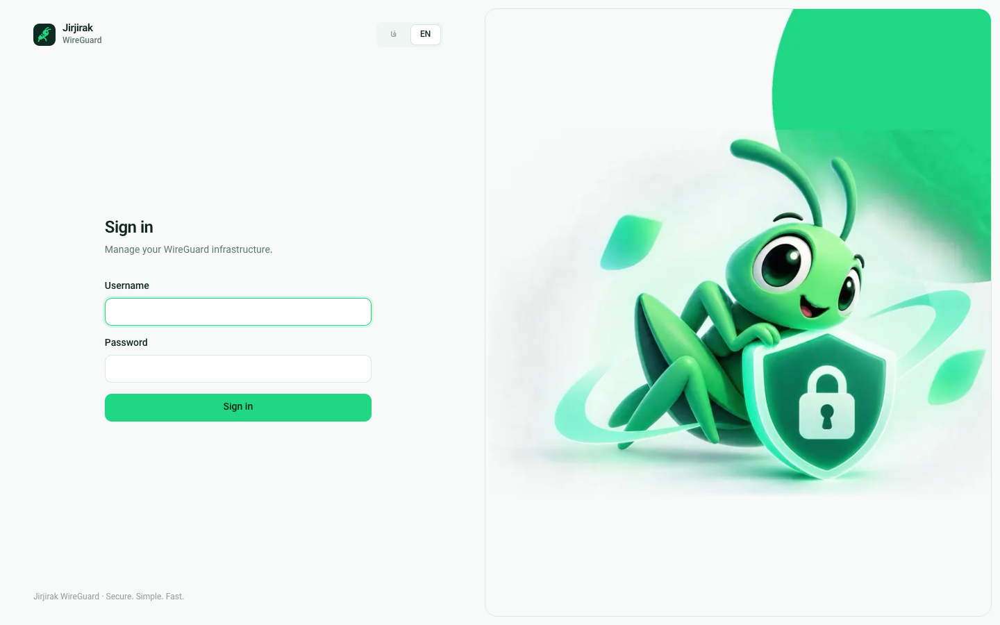</p>

Jirjirak WireGuard is a self-hosted panel for running your own WireGuard VPN service. It manages accounts (peers) and servers (nodes), lets resellers sell accounts under their own limits, and shows usage, connectivity and node health in one web dashboard. The panel is fully available in **English and Persian (RTL)**, in light and dark themes.

- **Multi-node by default.** Create an account once and it works on every server in its node group, not just one node.
- **Works out of the box.** Each node runs its own DNS resolver on the WireGuard gateway, and the agent checks the node's network and DNS at startup. Clients get internet as soon as they connect, even on networks that block public resolvers.
- **Live monitoring.** Per-account traffic charts, node CPU/RAM history, and online/offline status for every connection.
- **Reports.** Traffic, active and new accounts, quota usage, expiries, top accounts, per-node and per-reseller breakdowns over 24 hours to 1 year, with a table view and CSV export.
- **Resellers.** Give partners their own login with a plan: maximum accounts, traffic credit, allowed node groups and a plan expiry date. They see and manage only their own accounts and can issue their own API keys.
- **Service tiers.** Per-account data quota, expiry, device limit (with optional auto-suspend when a config is shared) and bandwidth limit, enforced on every node.
- **Subscription URLs.** Every account gets a stable link that always serves its latest config from the best node (load, health and region aware). You can rotate the link anytime without re-issuing keys.
- **Bot API.** Scoped, HMAC-signed API keys let a sales bot (e.g. Telegram) or a reseller's own tooling provision accounts. The API reference is served inside the panel.
- **Self-service domain & TLS.** Change the panel domain from Settings. Caddy provisions the certificate automatically.
- **Roles and audit log.** Super admin, operator, read-only support and reseller roles, with an audit trail of admin actions.

## Screenshots

**Dashboard.** Fleet status at a glance, with light and dark themes:

| Light | Dark |
| --- | --- |
| 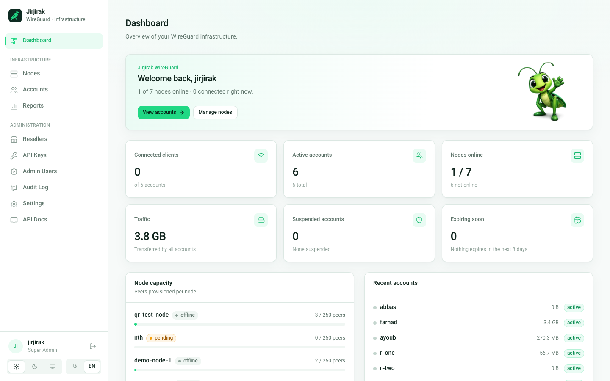 | 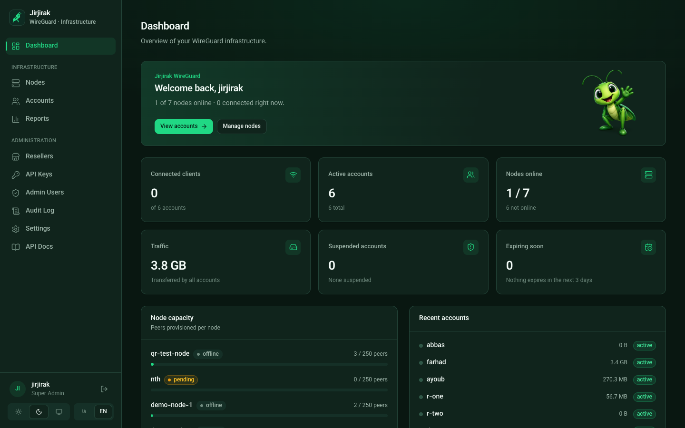 |

**Persian (RTL).** Every page is translated. Switch with the language toggle in the sidebar. Dates use the Jalali calendar in Persian:

| Dashboard | Reports |
| --- | --- |
|  |  |

**Reports.** Pick a range, scope to all accounts, admin-owned accounts or one reseller, and export CSV:

| Light | Dark |
| --- | --- |
| 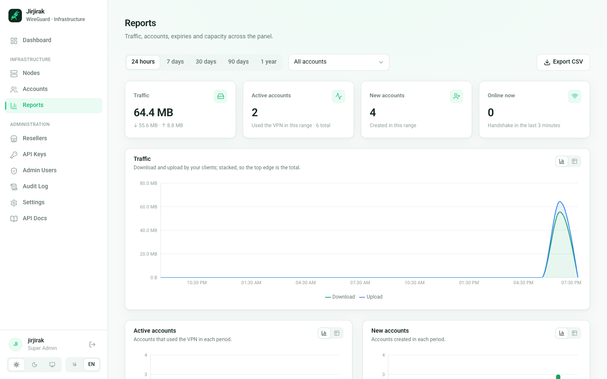 | 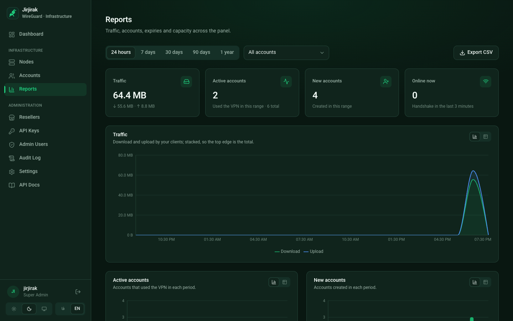 |

**Accounts.** The list shows usage against quota, expiry, owner and live status. The detail view has overview, devices, usage charts and inline editing, plus the subscription URL and per-node config/QR:

| Accounts | Account detail |
| --- | --- |
| 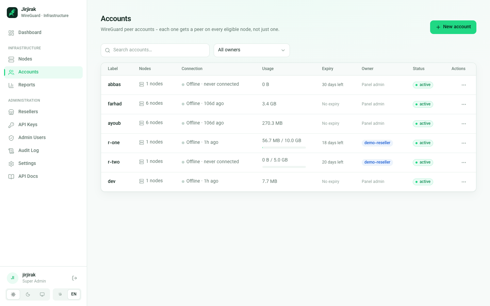 | 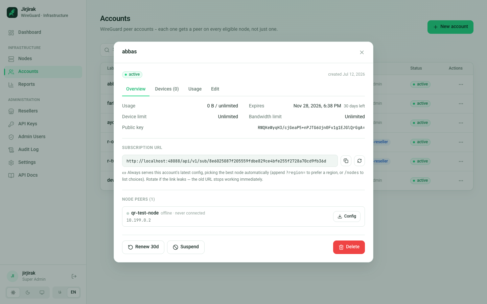 |

**Nodes.** Every WireGuard server with status, endpoint and capacity. When you add a node, the subnet picker disables ranges that are already used:

| Nodes | New node |
| --- | --- |
| 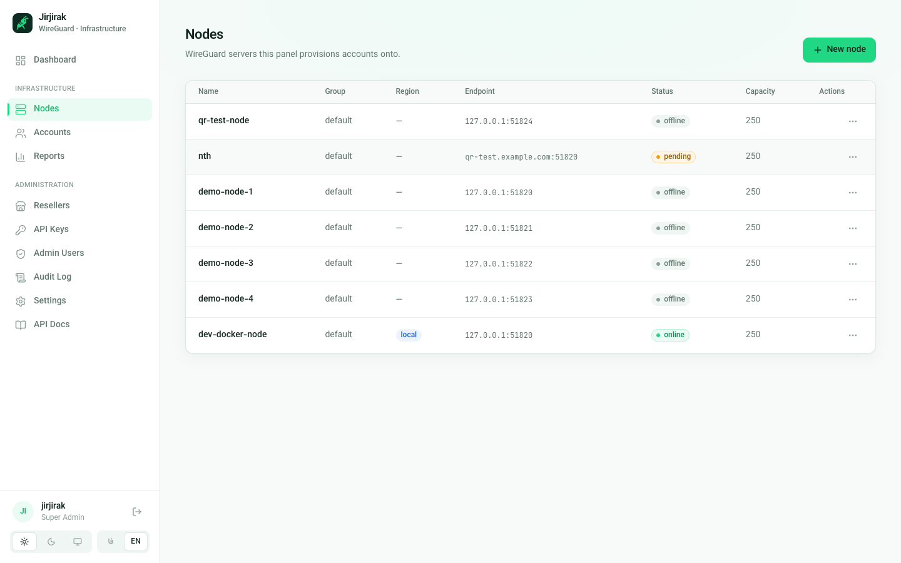 | 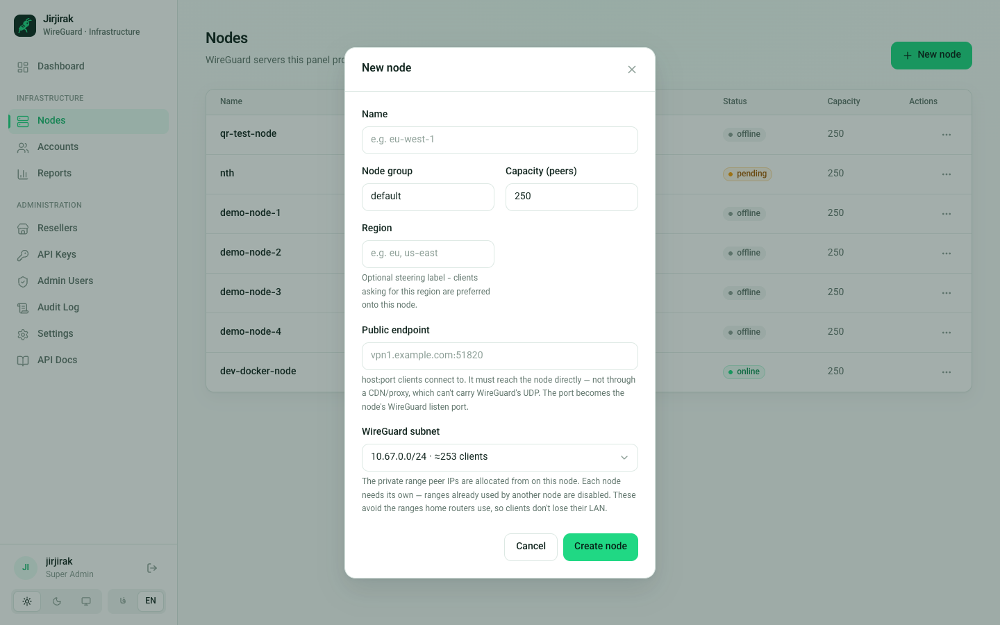 |

**Resellers.** Admins manage plans; resellers sign in to the same panel and see only their own accounts, plan usage and reports:

| Resellers (admin) | Reseller's dashboard |
| --- | --- |
| 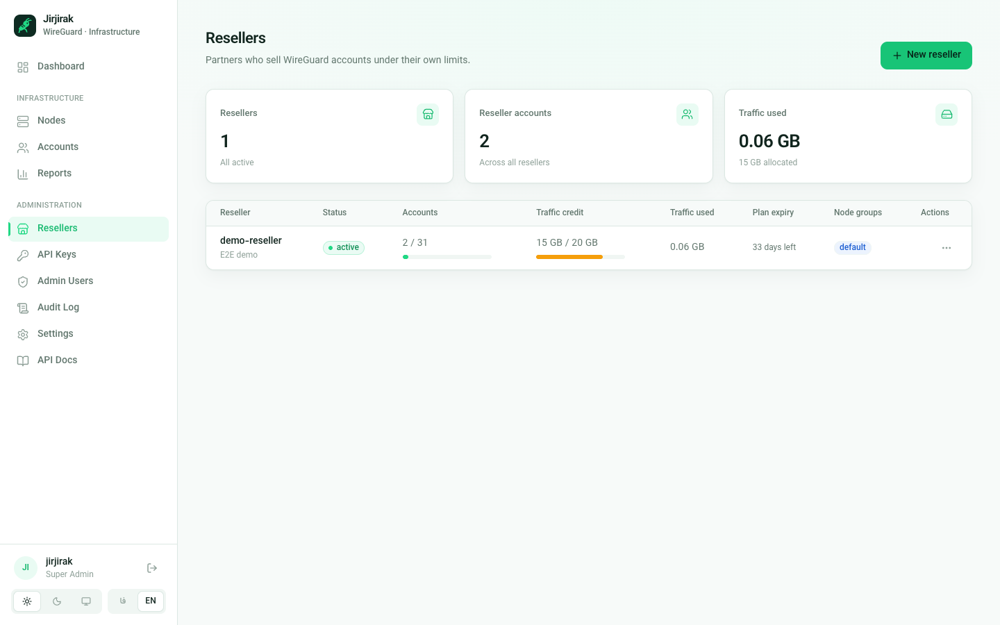 | 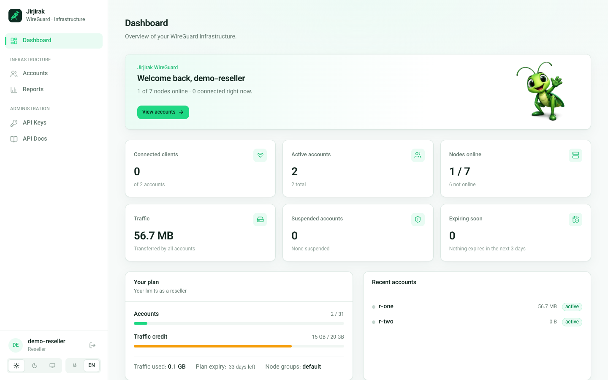 |

## Requirements

- A Linux server (Ubuntu/Debian) with a public IP, for the panel itself.
- A domain name pointed at that server's IP, if you want automatic HTTPS.
- Docker is installed automatically by the installer if it's missing.

## Installing the panel

Run this on the server that will host the panel:

```bash
curl -fsSL https://raw.githubusercontent.com/iamfarhad/WGPanel/main/deploy/install.sh -o install.sh
sudo bash install.sh
```

The installer will ask for:

- **Panel domain:** must already point at this server's IP (used for automatic HTTPS via Caddy).
- **Admin e-mail:** used for Let's Encrypt certificate notices.
- **Super-admin username:** the account you'll use to log into the panel.
- Whether to also set up WireGuard **on this same server** as your first node. This is recommended; you can add more servers later.

When it finishes, your panel is live at `https://<your-domain>`. The installer prints the generated super-admin password once at the end, so save it right away. You can recover it later with `wgpanel show-bootstrap-admin`, as long as the container's log history hasn't rotated it out.

> **Port 80 already in use?** If another web server owns port 80 on the host, set `PANEL_HTTP_PORT` to a free port in `/opt/wgpanel/.env` and run `docker compose up -d` again. Caddy then gets its certificate through the TLS-ALPN challenge on port 443 instead.

> **Starting over?** Re-running `install.sh` keeps your existing `.env` and data. To wipe everything (containers, data volumes, secrets and the self-node) and install fresh, run `sudo bash install.sh --fresh`. The panel binds high, rarely used host ports by default (e.g. the node-agent port is `48443`). The installer stops with a clear message if a port is already taken.

## Adding more WireGuard servers

Every node, including the panel's own server, is added the same way:

1. In the panel, go to **Nodes → New node** and fill in its name, capacity and WireGuard subnet.
2. Click **Join token** to generate a one-time token.
3. On the new server, run:

   ```bash
   curl -fsSL https://raw.githubusercontent.com/iamfarhad/WGPanel/main/deploy/install-node.sh -o install-node.sh
   sudo bash install-node.sh
   ```

4. Paste in the control-plane address and the join token when prompted.

The node appears as **online** in the panel within a few seconds. Every existing account automatically gets a peer on it, with no manual sync step.

> Re-registering a node's agent (rebuilt server, replaced hardware)? Generate an **unlimited** join token instead of a normal one (checkbox in the Join token dialog) so you don't have to reset anything manually.

### Clients that can't reach a node directly

On networks that filter WireGuard to foreign servers, put a relay in front of the node. A relay is any server your users can reach that forwards UDP to the node's WireGuard port, for example over a reverse TCP tunnel.

Open **Nodes → ⋯ → Entry endpoints** and add the relay as an endpoint: a label, its `host:port`, a priority, an optional MTU and a health check. Generated configs and subscription links then point clients at the **highest-priority healthy** endpoint and fall back to the node's own **Public endpoint** when none is healthy, so a node without endpoints behaves exactly as before.

- **Health check:** `TCP connect` dials the endpoint's `host:port` (many relays also listen on TCP on the same port) every minute with a 3 second timeout. `None` treats the endpoint as always healthy. **Check now** runs it on demand.
- **Per-endpoint MTU:** overrides the panel-wide client MTU for clients that use this endpoint.
- **Staff only:** resellers just benefit from the choice. In an account's detail you can download a config for a specific endpoint (`GET /api/v1/accounts/{id}/config?endpoint_id=<id|direct>`).

## Subscription page for your customers

Opening a subscription link in a browser shows a mobile-friendly page (Persian by default, with an English toggle) instead of a raw config. It shows the status, used and total traffic with a bar, days left, devices in use, a QR code, a config download, and install links for the official WireGuard apps (Android, iOS, Windows, macOS) with short instructions.

The same URL still serves the config to WireGuard clients, curl and bots: a request is treated as a browser only when its `Accept` header lists `text/html`, and `?format=conf` always returns the config. The page itself lives at `/s/<token>` and reads `GET /api/v1/sub/<token>/info`. If you set a separate **Subscription domain**, that domain serves only the subscription endpoints and this page. Nothing of the admin panel is reachable on it. The info endpoint returns only the account the token belongs to, and the subscription endpoints are rate limited per client IP, with a much stricter allowance for unknown tokens.

## Resellers

A super admin creates a reseller under **Resellers → New reseller** and sets the plan:

- **Max accounts:** how many accounts the reseller can hold at once.
- **Traffic credit:** the total quota the reseller can hand out. Creating or renewing an account draws from it.
- **Node groups:** which servers the reseller's accounts may use.
- **Plan expiry:** after this date the reseller can no longer sign in or use their API keys. Their existing accounts keep working until they expire, unless an admin suspends them.

Resellers sign in to the same panel. They see a reduced menu (Dashboard, Accounts, Reports, API Keys, API Docs), only their own accounts, and a plan card with remaining capacity and days left. Each reseller can create API keys for their own bot; those keys are limited to the reseller's namespace and node groups.

## Bot API

Bots and integrations authenticate with an API key from **API Keys**. Each request is signed with HMAC-SHA256:

```
X-API-Key:   <key_id>
X-Timestamp: <unix seconds, within ±5 minutes>
X-Signature: hex(HMAC_SHA256(secret, METHOD + "\n" + PATH + "\n" + TIMESTAMP + "\n" + BODY))
```

`PATH` is the URL path without the query string. `BODY` is the exact raw request body (empty for `GET`). The full reference is in [`docs/openapi.yaml`](docs/openapi.yaml) and is also served by every panel at `/api-docs.html`.

What a sales bot typically uses:

- **Idempotent creates.** Send an `external_ref` that is unique per order (for example `tg:<user id>:<order id>`). If a create's answer is lost, the retry gets `409 external_ref_taken`. `GET /api/v1/accounts?external_ref=<ref>` then returns that account, including a deleted one, because a ref stays taken after a delete.
- **Paging.** `GET /api/v1/accounts?limit=200&offset=<n>` lists the key's own accounts, oldest first, 200 per page. For long lists prefer cursor paging: start with `?cursor=` (empty), then pass each response's `next_cursor` until it is `null`. It stays correct while accounts are created or deleted between pages.
- **Rate limits.** Each key has a token bucket (default 20 requests/second, burst 40; change both under **Settings**). Every keyed response carries `X-RateLimit-Limit`, `X-RateLimit-Remaining` and `X-RateLimit-Reset`. When the bucket is empty you get `429 rate_limited` with a `Retry-After` header: wait that many seconds and retry.
- **A fresh period.** `POST /api/v1/accounts/{id}/reset-usage` sets the usage back to zero and brings back an account that was suspended for running out of data. A reseller key whose reseller has a traffic credit gets `403 reseller_reset_not_allowed`; it renews with `add_quota_gb` instead, which spends credit.
- **Removing a limit.** In `PATCH /api/v1/accounts/{id}`, `null` means "unchanged". To remove a cap, send `"clear_data_quota": true` or `"clear_device_limit": true`.
- **Who is online.** Every account carries `last_handshake_at`, the newest handshake across its nodes.

**Data caps are enforced.** An account whose usage reaches its quota is suspended with `suspend_reason: quota_exceeded` on the next traffic sample (it can go over by up to one heartbeat of traffic), and every node drops it. Raising the quota above the usage, a renewal, `reset-usage` or `clear_data_quota` brings it back. `POST …/enable` refuses an account still over its cap with `409 quota_exhausted`. If an account is both expired and over its cap, `expired` wins: adding data does not bring back an expired account. A quota of `0` is a zero-byte cap, not unlimited; omit the quota (or send `null`) for unlimited.

## Speed and connection quality

- **Client MTU.** **Settings → Client MTU** (default 1280, allowed 1200-1420) is the `MTU` line of every generated config. Raise it for speed on clean paths; keep it low if clients connect but large pages stall. An endpoint's own MTU overrides it. It applies to the next config download.
- **MSS clamping.** Node containers add `iptables -t mangle -A FORWARD -p tcp --tcp-flags SYN,RST SYN -j TCPMSS --clamp-mss-to-pmtu` (and the `ip6tables` twin when the kernel supports it) so forwarded TCP never exceeds the path MTU. Existing nodes pick it up when their container is recreated (`docker compose pull && docker compose up -d` in `/opt/wgpanel-node`).
- **Host tuning.** Both installers apply it, and `wgpanel tune` does the same on an existing server. It writes `/etc/sysctl.d/90-wgpanel-net.conf` with BBR + `fq` (only if the kernel has BBR), 16 MB socket buffers, a larger packet backlog, a conntrack table sized to RAM and TCP MTU probing, plus a small `wgpanel-net-tune.service` that turns on UDP GRO forwarding for the default NIC at boot when it is supported. A knob the kernel lacks is skipped, never fatal.

```bash
sudo wgpanel tune status    # current vs target values (no root needed for status)
sudo wgpanel tune apply     # write the sysctl file + unit and load them (idempotent)
sudo wgpanel tune revert    # remove the file and unit and restore the previous values
```

On a node-only server (installed with `install-node.sh`) there is no `wgpanel` CLI, so re-run `install-node.sh` or copy `deploy/wgpanel` to the server to use `wgpanel tune`.

## Managing the stack

The installer places a `wgpanel` CLI on the panel server:

```bash
wgpanel status               # container + API health
wgpanel logs [service]       # tail logs
wgpanel backup               # dump the database + .env to deploy/backups
wgpanel update               # backup, pull latest images, redeploy, auto-rollback on failed health check
wgpanel doctor               # disk space, container/DB/Redis health, TLS cert expiry, backup freshness
wgpanel create-admin         # add another admin account
wgpanel tune [apply|status|revert]  # host network tuning (BBR, buffers, conntrack)
```

Run `wgpanel` with no arguments for the full command list.

## Using the panel

- **Dashboard:** fleet-wide stats (connected clients, active accounts, nodes online, traffic, suspended and soon-to-expire accounts), node capacity and recent accounts.
- **Accounts:** create a WireGuard account, set a data quota, device limit, bandwidth limit and expiry, and download the `.conf` or scan the QR code. Days left and near-expiry badges show at a glance which accounts need renewing.
- **Nodes:** see live status, edit capacity, endpoint and region, and view CPU/RAM history for each server.
- **Reports:** traffic and account trends with per-node and per-reseller breakdowns, and a table view for every chart.
- **Resellers:** create resellers and manage their plans.
- **API Keys:** issue scoped, HMAC-signed keys for bots and resellers.
- **Settings:** panel defaults (quota, device limit, node capacity, client DNS) and live domain/TLS management.

## For developers

Architecture notes, the API reference and design docs for each feature area live in [`docs/`](docs). Start with [`docs/openapi.yaml`](docs/openapi.yaml) for the API surface.

### Repo layout

| Path | What it is |
| --- | --- |
| `backend/` | Go 1.26 control plane. `cmd/api` (the panel API + node-agent server) and `cmd/agent` (the WireGuard node agent, including its DNS forwarder). SQL migrations in `internal/store/migrations`. |
| `frontend/` | React 19 + TypeScript + Vite + Tailwind SPA. Translations live in `src/locales/` (English text is the key; Persian per page in `src/locales/fa/`). |
| `deploy/` | Docker Compose, Caddy, the `install.sh` / `install-node.sh` installers and the `wgpanel` management CLI. |
| `docs/` | Product/architecture docs, `openapi.yaml` and the README screenshots. |

### Local development

Everything runs from `deploy/` with Docker Compose. When you run Compose from this directory, it merges `docker-compose.yml` (production) with `docker-compose.override.yml` (dev-only). A local `up` therefore builds the images from source and makes the in-Docker WireGuard test node available. None of that ships to production.

```bash
cd deploy
cp .env.example .env          # then set the CHANGE_ME secrets; for local use, point the
                              # image vars at local tags, e.g. API_IMAGE=wgpanel-api:local
                              # and FRONTEND_IMAGE=wgpanel-frontend:local
docker compose up -d --build  # build + start db, redis, api, frontend, caddy
docker compose logs -f api    # the one-time bootstrap admin password is printed here
```

You can also run a WireGuard node in Docker, which is handy on macOS where `install-node.sh` can't run natively. Generate a join token in the panel (**Nodes → New node → Join token**), put it in `.env` as `NODE_JOIN_TOKEN`, then:

```bash
docker compose --profile node up -d wg-node
```

**Working on the frontend alone.** Vite's dev server proxies `/api` to the backend, so you get hot reload against the running API stack. The default backend is `http://127.0.0.1:48080`, matching `API_PORT`; override it with `VITE_BACKEND_URL`.

```bash
cd frontend
npm ci
npm run dev        # http://localhost:5173
npm run lint       # oxlint
npm run build      # type-check (tsc -b) + production build
```

**Working on the backend alone:**

```bash
cd backend
go test ./...
go vet ./...
gofmt -l .         # must print nothing
```

Integration tests (resellers, reports) run against a real TimescaleDB when `WGPANEL_TEST_POSTGRES_DSN` is set and are skipped otherwise. `internal/httpapi/openapi_sync_test.go` fails if `docs/openapi.yaml` and `frontend/public/openapi.yaml` drift apart, so update both when you change the API.

A browser-driven smoke test exercises the whole panel against a running stack: `node frontend/e2e-smoke.mjs` (see the file header for the env vars it takes).

### Production vs. dev Compose

- **`docker-compose.yml`** is production-only. It runs five services (db, redis, api, frontend, caddy) with pinned image digests, bounded logs, per-service memory limits, `no-new-privileges` and healthchecks. It pulls `API_IMAGE` / `FRONTEND_IMAGE` and never builds. `install.sh` copies just this file to the server.
- **`docker-compose.override.yml`** adds the local `build:` directives and the dev `wg-node`. It lives only in the repo and is never deployed.

Per-container memory ceilings are tunable via `.env` (`DB_MEM_LIMIT`, `REDIS_MEM_LIMIT`, `API_MEM_LIMIT`, …). See the comments in `.env.example`; small 1 GB hosts run fine with tighter limits.

### Images & CI

Pushes to `main` build and publish three images to GHCR via `.github/workflows/build-{api,frontend,node}.yml`. Each image is tagged `latest` and `sha-<commit>`:

- `ghcr.io/iamfarhad/wgpanel-api`: the control plane (also contains the agent binary).
- `ghcr.io/iamfarhad/wgpanel-frontend`: the SPA served by nginx.
- `ghcr.io/iamfarhad/wgpanel-node`: the production WireGuard node (`deploy/node.Dockerfile`), run as a container by both installers.

Pull requests run the same tests without publishing. Both installers deploy nodes as **production Docker containers**: bridge networking, with the container NATing client traffic in its own namespace. If the published `wgpanel-node` image can't be pulled (for example before CI has run, or from a private package), they fall back to building it from source on the host. If you fork the repo, update `API_IMAGE` / `FRONTEND_IMAGE` / `NODE_IMAGE` in `.env.example` and make the GHCR packages public.
